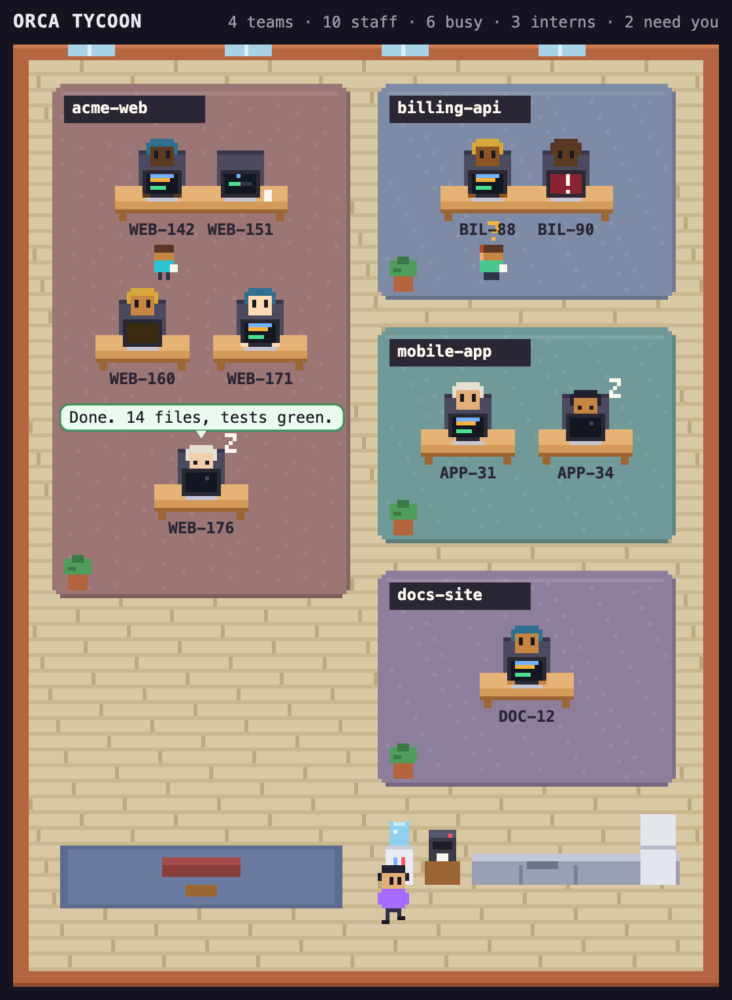
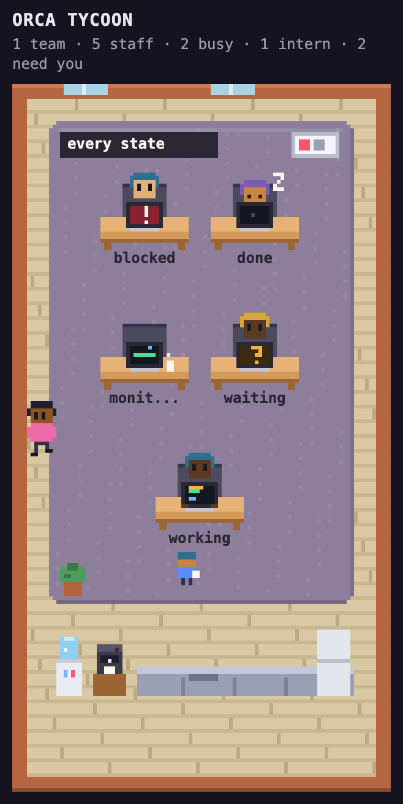
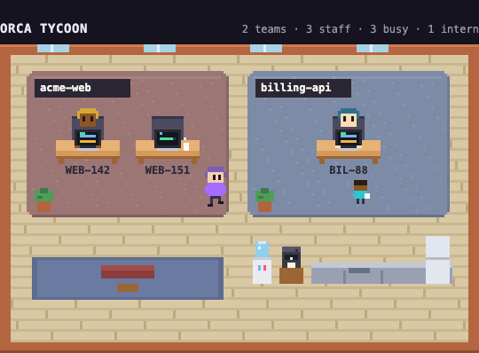

# Orca Tycoon

Your coding agents, as tiny pixel staff in an office you can watch.



Orca Tycoon is a plugin for [Orca](https://github.com/stablyai/orca), the desktop app for running
many coding agents in parallel git worktrees. It draws every agent on your machine as a little
worker in an office, in the style of tycoon and office-sim games. You get a glance at who is busy,
who needs you and who is done, without having to click through every workspace.

## Install

Requires Orca 1.4.246 or newer.

```sh
git clone https://github.com/palulabs/orca-tycoon.git
cd orca-tycoon
orca plugin dev load .        # prints an approval; re-run with the --approve flag it shows
orca plugin open local.orca-tycoon --panel office
```

The worker looks for the Orca CLI at `/Applications/Orca.app/Contents/Resources/bin/orca`, then
`~/Applications/...`, then `orca` on your `PATH`.

## Who works here

- **Projects are teams.** Each repository gets its own open area on the office floor.
- **Agents get desks.** Every agent has a seat with a monitor facing you. A worktree's child
  worktrees sit right next to it, so a stack of branches reads as one row of desks.
- **Subagents are interns.** They walk around in front of their parent's desk while they work.
- **Background tasks mean a coffee break.** An agent whose turn is over but whose background tasks
  are still running gets up, walks to the coffee corner and comes back when the tasks finish.
- **Agents speak up.** When an agent finishes, a speech bubble shows the first line of its last
  reply. When one starts waiting for you it says "Need you!", and when it gets stuck it says
  "Stuck!".

A status line along the top counts teams, staff, busy agents and how many need you.

## Reading the monitors



| Agent state | What you see |
| --- | --- |
| working | typing, code scrolling on screen |
| watching background tasks | away at the water dispenser or coffee machine, mug in hand |
| waiting for you | amber `?` on screen |
| blocked | red flashing screen with `!` |
| done | dozing, `z` |

Click a seat to pin its speech bubble and see the worktree, state, task, current tool and interns.



## How it works

Orca's plugin API (`agents.list`) only lists the agents of the focused workspace, and it has no
subagents. To see the whole office, the worker (`src/worker.ts`) runs `orca worktree ps --json`
instead. Orca's own sidebar and phone app draw from the same rows. The worker trims them to a small
office model (`src/protocol.ts`).

The panel (`src/panel.html`, `src/panel.js`, `src/sprites.js`) polls the worker every 3 seconds,
the same rate Orca's phone app uses, and draws one canvas at 8 frames a second. Every sprite is
drawn in code, so the plugin loads no assets and makes no network requests.

### Permissions

Because the worker runs the Orca CLI, the plugin needs the `trusted-worker` execution profile. It
asks for no other capabilities.

## Develop

```sh
orca plugin validate .
orca plugin test .            # src/worker.test.ts: ps rows to the office model
orca plugin dev reload .      # after editing; the panel redraws
orca plugin shot local.orca-tycoon --panel office --out shot.png
```

`AWAY_STATES` at the top of `src/panel.js` decides which states send an agent to the coffee corner.
Out of the box it's only `monitoring`. Add `waiting` if you'd like agents that wait for you to go
get a coffee too.

The screenshots in `docs/` show a made-up office, rendered from the real panel code.

## License

[MIT](LICENSE)

Orca Tycoon is a community plugin and is not affiliated with Orca or Stably.
